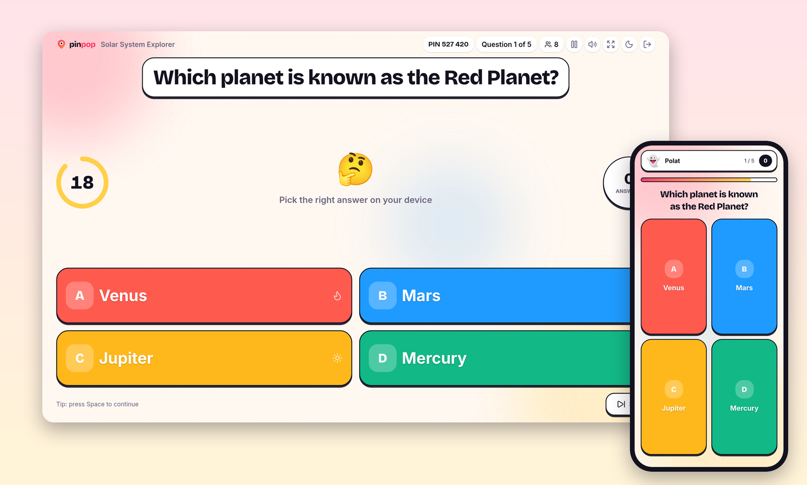
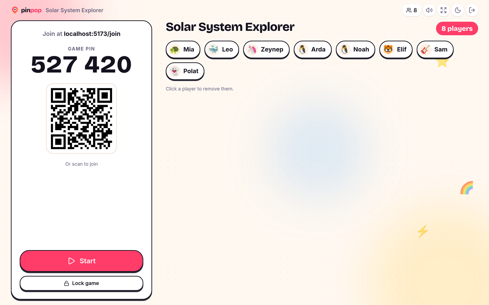
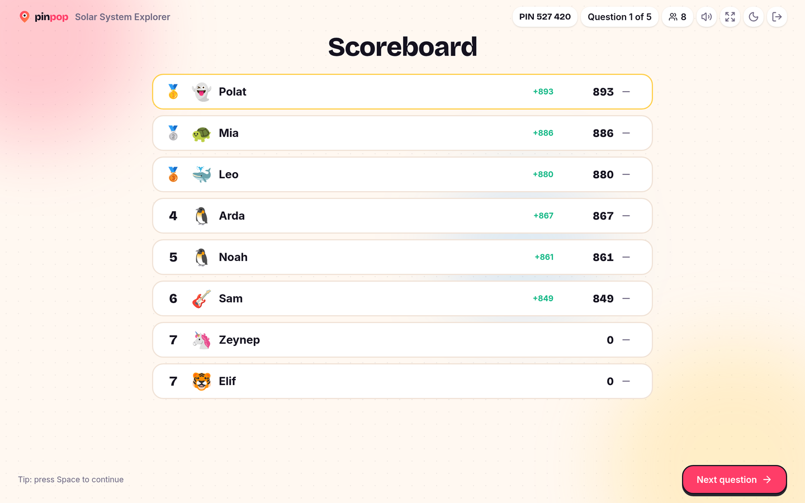
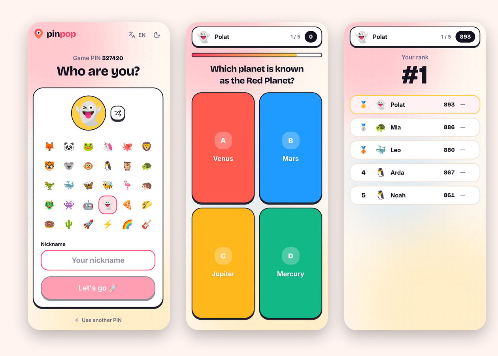
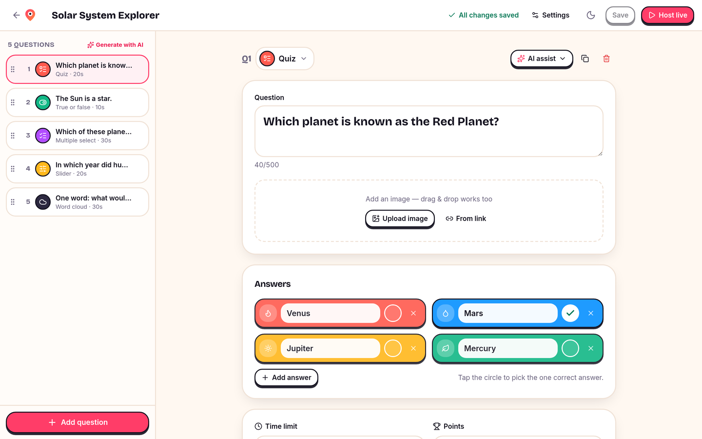
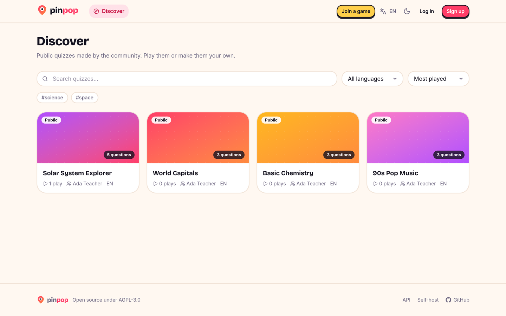
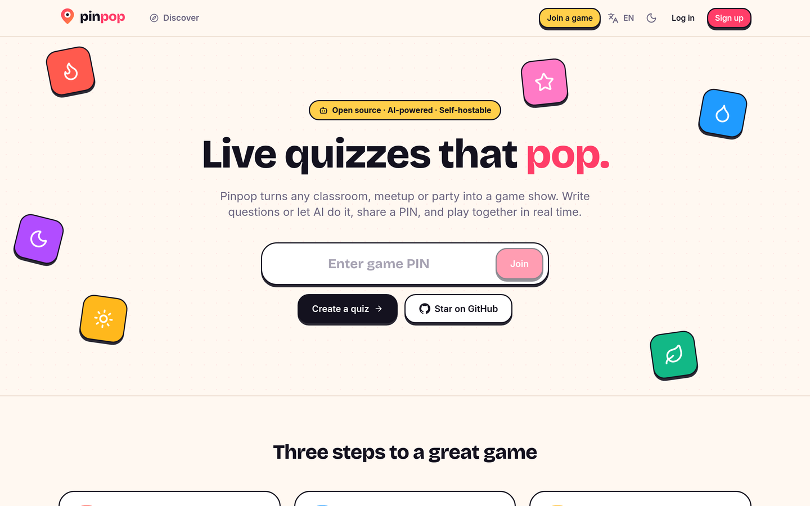
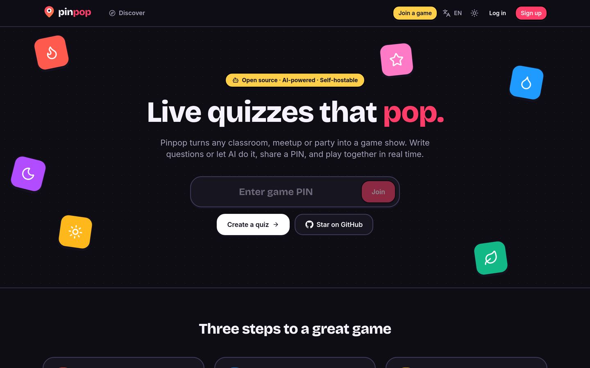

<div align="center">


# Pinpop

**The open-source live quiz platform. Create a quiz, let AI write the questions, play it live on the big screen.**

Self-host it with one command, or use it with Claude, Cursor and other AI tools through MCP.

[Features](#features) · [Screenshots](#screenshots) · [Quick start](#quick-start) · [AI](#ai-question-generation) · [MCP](#mcp-use-pinpop-from-claude-cursor) · [Docs](docs/) · [Türkçe](README.tr.md)

[](https://github.com/polatAI/pinpop/actions/workflows/ci.yml)
[](LICENSE)
[](https://www.python.org)
[](https://fastapi.tiangolo.com)
[](https://github.com/polatAI/pinpop/pkgs/container/pinpop)
[](docs/mcp.md)
[](CONTRIBUTING.md)

<br />



</div>

---

## Features

**🎮 Live games**

- Players join with a 6-digit PIN or a QR code on any phone. No app and no account needed
- Separate host screen for the projector and player screen for phones
- Speed-based scoring, answer streak bonuses, live leaderboard and an animated podium
- Players can reconnect mid-game, and late joining is optional
- The host can lock the game, kick players, pause, skip, and turn on auto-advance
- Built-in profanity filter for nicknames, or random fun nicknames
- Sounds are synthesised in the browser, so there are no audio assets to license

**📚 Homework mode:** share a link, students play at their own pace (timed questions, no account needed) and results land in your reports

**❓ 8 question types:** quiz (single answer) · multiple select · true/false · type the answer · slider estimate · put in order · poll · word cloud

**🤖 AI question generation**

- Generate from a topic, pasted text, a **web page** or a **PDF**
- Rewrite single questions: make harder or easier, write better distractors, add an explanation, rephrase
- Works with **Claude (Anthropic)**, **OpenAI**, **OpenRouter**, **Ollama (local, free)** and any OpenAI-compatible API
- Use one AI key for the whole server, let each user bring their own key (stored encrypted), and set a daily limit if you want

**🔌 MCP and API**

- A **remote MCP server** is built in at `/mcp`, and the Python package ships a **stdio** command `pinpop-mcp`
- Tell Claude _"make a 10-question quiz about the solar system and start a game"_ and get a PIN back
- Full REST API with an OpenAPI/Swagger UI at `/api/docs` and personal API tokens

**✏️ Editor and library**

- Drag-and-drop editor with images, time limits, double points and explanations
- Import and export as JSON or CSV/Excel spreadsheets
- Public library to discover quizzes and copy (fork) them into your own

**📊 Reports:** every game is saved with per-question accuracy, the hardest questions, per-player answers and a CSV export

**🛡️ Built for self-hosting**

- One Docker image. PostgreSQL is used if you have it, otherwise a zero-setup SQLite file
- Accounts with email and password plus optional GitHub/Google login. The first user becomes admin
- GDPR-friendly: export your data or delete your account in one click. No tracking, no third-party fonts or CDNs
- Turkish and English UI, dark mode, installable PWA, accessible answer tiles (colour + letter + icon)

## Screenshots

<table>
  <tr>
    <td width="50%"><br /><sub><b>Host screen:</b> lobby with PIN and QR code</sub></td>
    <td width="50%"><br /><sub><b>Live scoreboard</b> after every question</sub></td>
  </tr>
  <tr>
    <td colspan="2"><br /><sub><b>On players' phones:</b> pick an avatar, answer, see your rank</sub></td>
  </tr>
  <tr>
    <td><br /><sub><b>Editor</b> with AI generation and 8 question types</sub></td>
    <td><br /><sub><b>Discover</b> public quizzes and fork them</sub></td>
  </tr>
  <tr>
    <td><br /><sub>Light</sub></td>
    <td><br /><sub>Dark</sub></td>
  </tr>
</table>

## Quick start

### Docker (recommended)

```bash
git clone https://github.com/polatAI/pinpop.git && cd pinpop
cp .env.example .env        # set PUBLIC_URL, APP_SECRET and POSTGRES_PASSWORD
docker compose up -d
```

Open <http://localhost:3000> and create an account. The first account becomes the admin.

### Single container, no Postgres

```bash
docker run -d -p 3000:3000 -v pinpop-data:/data \
  -e PUBLIC_URL=http://localhost:3000 \
  -e APP_SECRET=$(openssl rand -hex 32) \
  ghcr.io/polatai/pinpop:latest
```

Without `DATABASE_URL`, data is stored in an SQLite database inside the `/data` volume.

### From source

You need Python 3.13 with [uv](https://docs.astral.sh/uv) and Node.js 22+ with pnpm.

```bash
make install
make dev            # Python API on :3000, web app on http://localhost:5173
```

More deployment guides are in **[docs/self-hosting.md](docs/self-hosting.md)**: reverse proxy (Caddy and nginx), Render, Railway, Coolify, backups and upgrades.

## AI question generation

Set a provider for the whole server in `.env`:

```bash
AI_PROVIDER=anthropic          # anthropic | openai | openrouter | ollama | openai-compatible
AI_API_KEY=sk-ant-...
# AI_MODEL=claude-opus-5-5     # optional, defaults per provider
# AI_DAILY_LIMIT=20            # optional, generations per user per day
```

You can also leave it empty and let users add their own key under **Settings → AI**. To run fully offline, use [Ollama](https://ollama.com): `AI_PROVIDER=ollama`, `AI_BASE_URL=http://host.docker.internal:11434/v1`. More in [docs/ai.md](docs/ai.md).

## MCP: use Pinpop from Claude, Cursor…

1. In Pinpop, open **Settings → API & MCP** and create a token.
2. Connect your client.

**Claude Code** (remote server):

```bash
claude mcp add --transport http pinpop https://your-pinpop.example.com/mcp \
  --header "Authorization: Bearer pp_your_token"
```

**Claude Desktop / Cursor** (stdio, needs [uv](https://docs.astral.sh/uv)):

```json
{
  "mcpServers": {
    "pinpop": {
      "command": "uvx",
      "args": ["--from", "git+https://github.com/polatAI/pinpop#subdirectory=backend", "pinpop-mcp"],
      "env": { "PINPOP_URL": "https://your-pinpop.example.com", "PINPOP_TOKEN": "pp_your_token" }
    }
  }
}
```

Available tools: `create_quiz`, `generate_quiz`, `add_questions`, `update_quiz`, `get_quiz`, `list_quizzes`, `discover_quizzes`, `delete_quiz`, `start_game`, `get_game_status`, `list_reports`, `get_report`. See [docs/mcp.md](docs/mcp.md).

## Architecture

```
backend/    Python 3.13 · FastAPI · python-socketio · SQLAlchemy + Alembic (PostgreSQL / SQLite)
            Pydantic models, game engine, AI providers (Anthropic SDK, OpenAI-compatible), MCP server
frontend/   React 19 · Vite · Tailwind CSS 4 single-page app (host, player, editor, dashboard)
```

The server is authoritative: answers are validated and scored on the server, solutions are never sent to players before the reveal, and game state is held in memory. One Python process comfortably runs many simultaneous games with hundreds of players each. Read [docs/architecture.md](docs/architecture.md) for details.

## Contributing

Contributions of every size are welcome: bug reports, translations, question types and docs. Start with [CONTRIBUTING.md](CONTRIBUTING.md).

```bash
make install
make dev        # run everything with hot reload
make test       # pytest: scoring, game engine, API, websockets, MCP, AI
make lint       # Ruff + Biome
make typecheck  # mypy (strict) + tsc
```

**Adding a language:** copy `frontend/src/locales/en` to a new folder, translate the four JSON files, and register the language in `frontend/src/lib/i18n.ts`.

## License

Pinpop is licensed under the [GNU AGPL-3.0](LICENSE). You can use, modify and self-host it freely. If you run a modified version as a public service, you must share your changes under the same license.

Pinpop is an independent project and is not affiliated with any commercial quiz platform.
