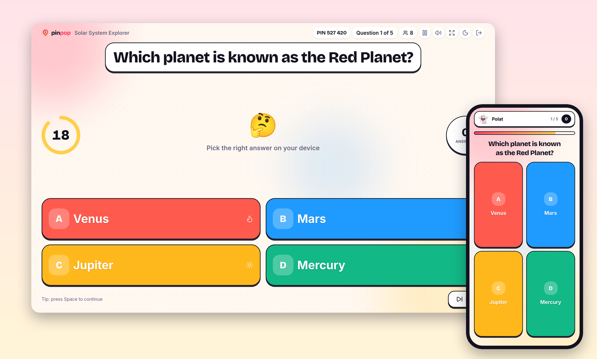
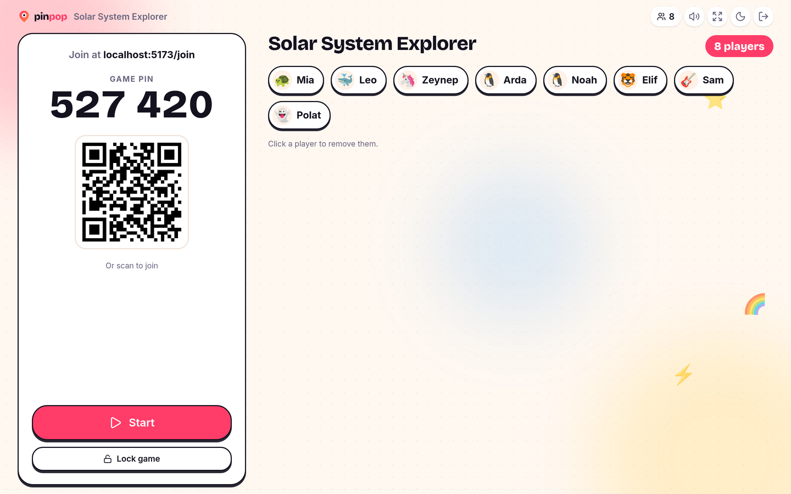
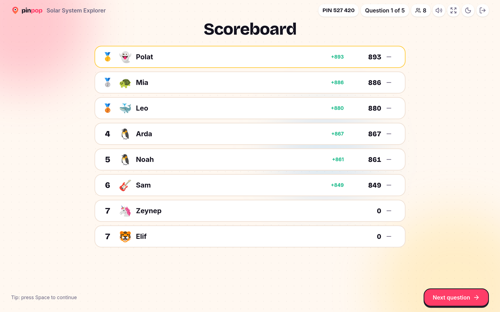
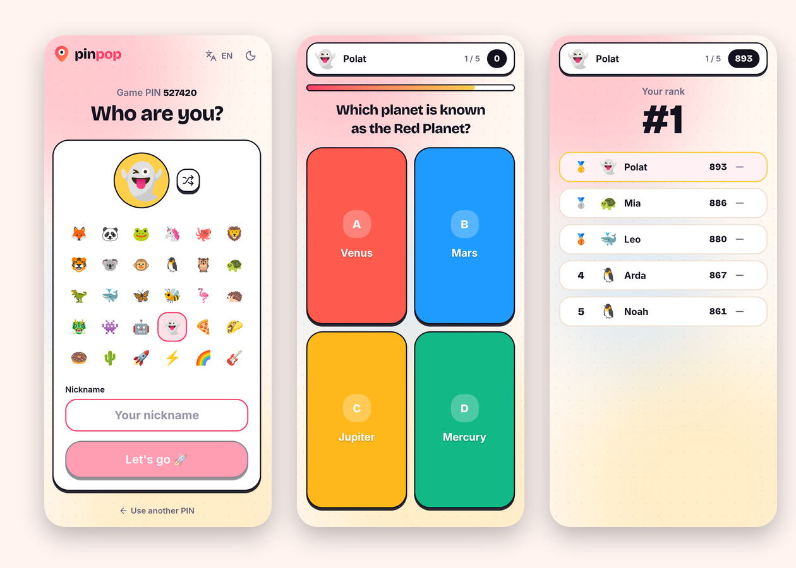
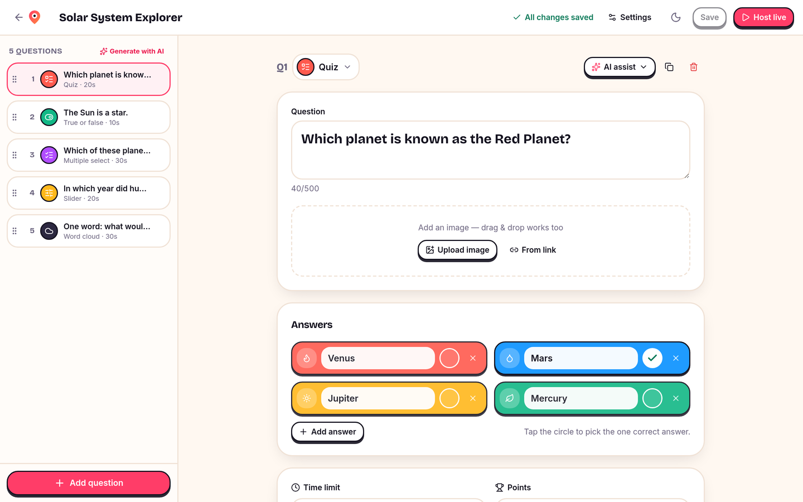
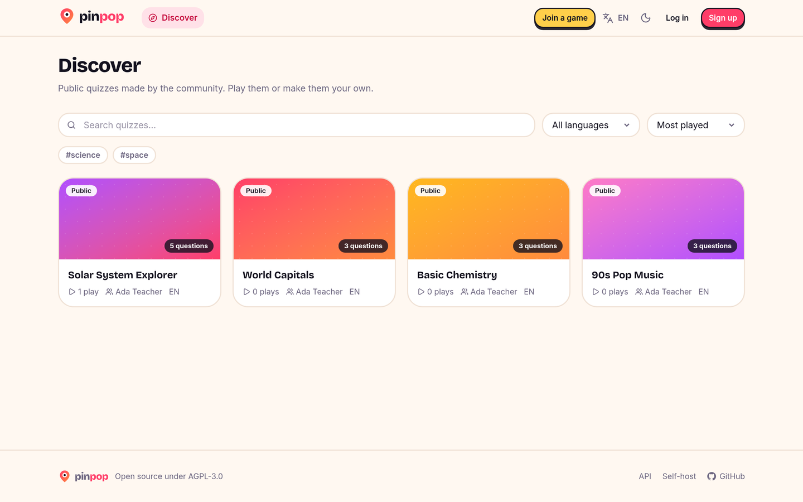
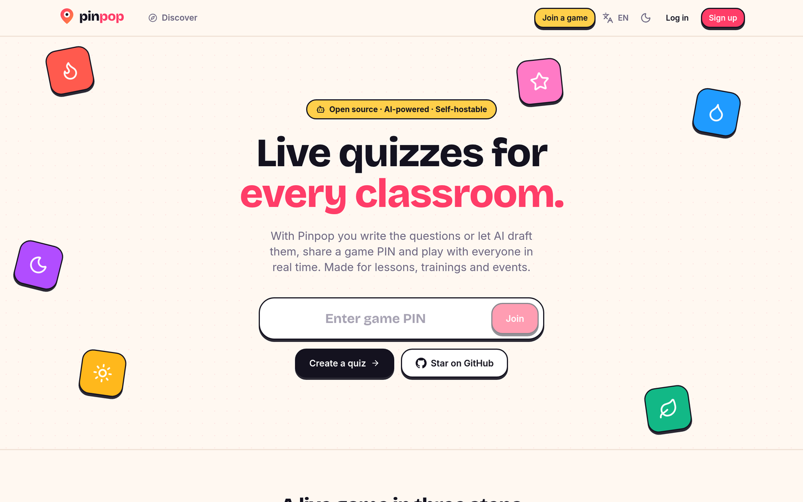
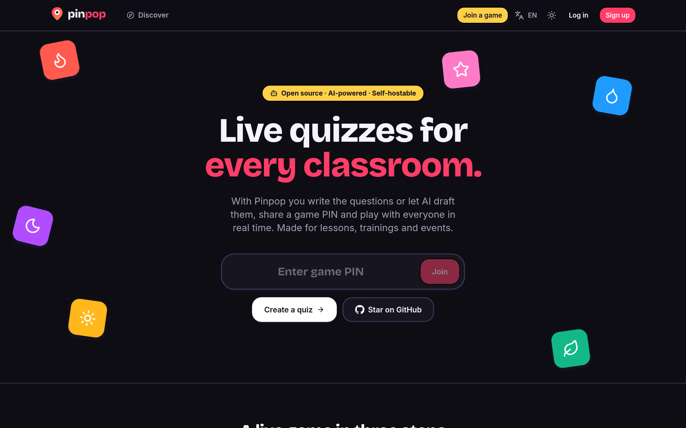

<div align="center">


# Pinpop

**Açık kaynak canlı quiz platformu. Quizini oluştur, soruları AI'a yazdır, büyük ekranda canlı oynat.**

Tek komutla kendi sunucunda çalıştır, ya da MCP üzerinden Claude, Cursor ve diğer AI araçlarıyla kullan.

### [▶ pinpop.cloud adresinde ücretsiz dene](https://pinpop.cloud)

Kurulum yok, oyuncular için uygulama da yok. Hesap aç ve ilk oyununu başlat.

[Özellikler](#özellikler) · [Ekran görüntüleri](#ekran-görüntüleri) · [Hızlı başlangıç](#hızlı-başlangıç) · [AI](#ai-ile-soru-üretme) · [MCP](#mcp) · [English](README.md)

[](https://pinpop.cloud)
[](https://github.com/polatAI/pinpop/actions/workflows/ci.yml)
[](LICENSE)
[](https://www.python.org)
[](https://fastapi.tiangolo.com)
[](https://github.com/polatAI/pinpop/pkgs/container/pinpop)
[](docs/mcp.md)
[](CONTRIBUTING.md)

<br />



</div>

---

## Özellikler

**🎮 Canlı oyun**

- Oyuncular 6 haneli PIN veya QR kod ile telefondan katılır. Uygulama ya da hesap gerekmez
- Projeksiyon için ayrı sunucu (host) ekranı, telefonlar için ayrı oyuncu ekranı var
- Hıza göre puanlama, seri (streak) bonusu, canlı sıralama ve animasyonlu podyum
- Bağlantısı kopan oyuncu kaldığı yerden devam eder. Oyun başladıktan sonra katılım isteğe bağlı açılabilir
- Sunucu oyunu kilitleyebilir, oyuncu atabilir, duraklatıp soru atlayabilir, otomatik ilerlemeyi açabilir
- Uygunsuz takma ad filtresi var. İstersen rastgele eğlenceli isimler de verilebilir
- Sesler tarayıcıda sentezlenir, lisans gerektiren ses dosyası yoktur

**📚 Ödev modu:** bir bağlantı paylaş, öğrenciler kendi hızlarında (süreli sorularla, hesapsız) çözsün, sonuçlar raporlarına düşsün

**❓ 8 soru tipi:** quiz (tek cevap) · çoklu seçim · doğru/yanlış · yazarak cevap · sayı tahmini · sıralama · anket · kelime bulutu

**🤖 AI ile soru üretme**

- Konu başlığından, metinden, **web sayfasından** veya **PDF'ten** soru üretir
- Tek bir soruyu zorlaştırır ya da kolaylaştırır, yanlış şıkları iyileştirir, açıklama yazar, yeniden ifade eder
- **Claude (Anthropic)**, **OpenAI**, **OpenRouter**, **Ollama (yerel, ücretsiz)** ve OpenAI uyumlu her API ile çalışır
- Sunucu geneli tek anahtar kullanılabilir, her kullanıcı kendi anahtarını da getirebilir (şifreli saklanır). İstersen günlük limit koyabilirsin

**🔌 MCP ve API**

- `/mcp` adresinde **uzak MCP sunucusu** hazır gelir, ayrıca Python paketiyle birlikte **stdio** komutu `pinpop-mcp` gelir
- Claude'a _"Güneş sistemi hakkında 10 soruluk quiz hazırla ve oyunu başlat"_ de, PIN'i alsın
- `/api/docs` adresinde OpenAPI/Swagger dokümanlı tam REST API ve kişisel API anahtarları

**✏️ Editör ve kütüphane:** sürükle-bırak editör, görsel, süre, çift puan, açıklama. JSON ve CSV/Excel içe-dışa aktarma. Herkese açık quiz kütüphanesi ve kopyalama

**📊 Raporlar:** her oyun kaydedilir. Soru bazında başarı, en zor sorular, oyuncu cevapları ve CSV çıktısı

**🛡️ Kendi sunucunda kurmaya uygun:** tek Docker imajı. Postgres yoksa kurulum gerektirmeyen bir SQLite dosyası kullanılır. İlk kullanıcı yönetici olur. KVKK/GDPR uyumlu veri dışa aktarma ve hesap silme. Takip kodu ya da harici CDN yok. Türkçe ve İngilizce arayüz, karanlık mod ve PWA desteği

## Ekran görüntüleri

<table>
  <tr>
    <td width="50%"><br /><sub><b>Sunucu ekranı:</b> PIN ve QR kodlu lobi</sub></td>
    <td width="50%"><br /><sub>Her sorudan sonra <b>canlı sıralama</b></sub></td>
  </tr>
  <tr>
    <td colspan="2"><br /><sub><b>Oyuncunun telefonunda:</b> avatar seç, cevapla, sıranı gör</sub></td>
  </tr>
  <tr>
    <td><br /><sub>AI destekli, 8 soru tipli <b>editör</b></sub></td>
    <td><br /><sub>Herkese açık quizleri <b>keşfet</b> ve kopyala</sub></td>
  </tr>
  <tr>
    <td><br /><sub>Açık tema</sub></td>
    <td><br /><sub>Koyu tema</sub></td>
  </tr>
</table>

## Hızlı başlangıç

En hızlı yol **[pinpop.cloud](https://pinpop.cloud)** adresindeki barındırılan sürüm: ücretsiz, kurulum gerektirmez. Kendi sunucunda çalıştırmak için:

```bash
git clone https://github.com/polatAI/pinpop.git && cd pinpop
cp .env.example .env        # PUBLIC_URL, APP_SECRET ve POSTGRES_PASSWORD'u ayarla
docker compose up -d
```

<http://localhost:3000> adresini aç ve hesap oluştur. İlk hesap yönetici olur.

Kaynaktan çalıştırmak için Python 3.13 + [uv](https://docs.astral.sh/uv) ve Node.js 22 + pnpm gerekir: `make install && make dev`. Detaylar [docs/self-hosting.md](docs/self-hosting.md) dosyasında.

## AI ile soru üretme

`.env` dosyasına ekle:

```bash
AI_PROVIDER=anthropic     # anthropic | openai | openrouter | ollama | openai-compatible
AI_API_KEY=sk-ant-...
```

Ya da boş bırak, kullanıcılar kendi anahtarlarını **Ayarlar → AI** bölümünden eklesin. Tamamen ücretsiz ve çevrimdışı kullanım için Ollama'yı seç. Detaylar [docs/ai.md](docs/ai.md) dosyasında.

## MCP

**Ayarlar → API & MCP** bölümünden bir anahtar oluştur. Sonra:

```bash
claude mcp add --transport http pinpop https://senin-pinpop-adresin/mcp \
  --header "Authorization: Bearer pp_anahtarin"
```

Claude Desktop ve Cursor yapılandırması için [docs/mcp.md](docs/mcp.md) dosyasına bak.

## Mimari

```
backend/    Python 3.13 · FastAPI · python-socketio · SQLAlchemy + Alembic (PostgreSQL / SQLite)
            Pydantic modelleri, oyun motoru, AI sağlayıcıları (Anthropic SDK, OpenAI uyumlu), MCP sunucusu
frontend/   React 19 · Vite · Tailwind CSS 4 tek sayfalık uygulama (sunucu ekranı, oyuncu, editör, panel)
```

Detaylar [docs/architecture.md](docs/architecture.md) dosyasında.

## Katkı

Her türlü katkıya açığız: hata bildirimi, çeviri, yeni soru tipi, doküman. Başlamak için [CONTRIBUTING.md](CONTRIBUTING.md) dosyasını oku.

## Lisans

[GNU AGPL-3.0](LICENSE). Özgürce kullanabilir, değiştirebilir ve kendi sunucunda çalıştırabilirsin. Değiştirilmiş bir sürümü herkese açık bir hizmet olarak sunarsan değişikliklerini aynı lisansla paylaşman gerekir.

Pinpop bağımsız bir projedir ve herhangi bir ticari quiz platformuyla bağlantısı yoktur.
